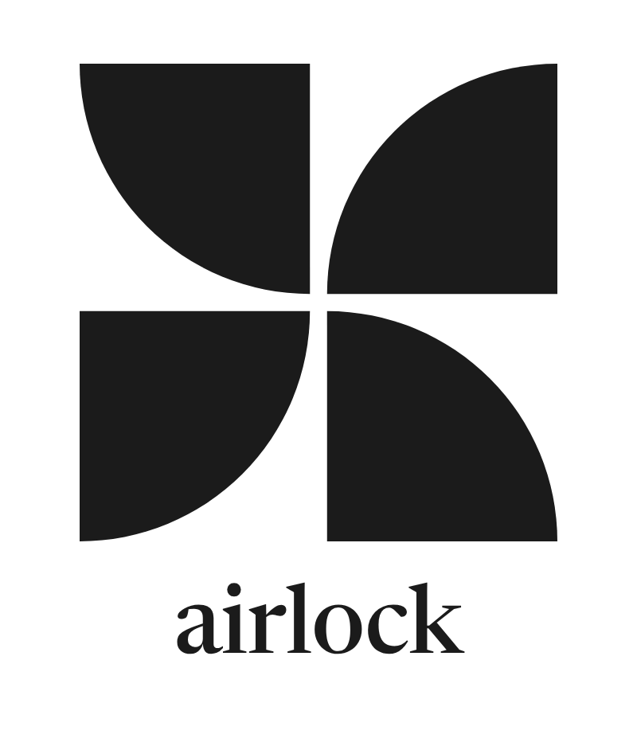

<p align="center">
  <picture>
    <source media="(prefers-color-scheme: dark)" srcset="https://raw.githubusercontent.com/tesseraline/airlock/production/assets/mark-dark.png">
    
  </picture>
</p>
<p align="center">
  <a href="https://pypi.org/project/tesseraline-airlock/"></a>
  <a href="https://github.com/tesseraline/airlock/blob/production/LICENSE.md"></a>
  
  
</p>

# tesseraline-airlock

```console
$ pip install tesseraline-airlock
```

[Changelog](CHANGELOG.md) · [Security](SECURITY.md) · [Threat model](docs/threat-model.md) · [Design](docs/design.md)

**An agent asks for an action. The gateway decides whether it happens and keeps the keys.**

## Why airlock

**It works on a different layer.** Content guardrails check what a model says. Airlock checks what an agent does:
which tool it calls, with which arguments, where the request goes on the network and whose key it uses. The two
work together. Airlock can sit behind an AI gateway or inside a service mesh.

**The agent never holds a key.** Keys for tools and for model APIs stay in the gateway, which adds them to each
request. A key in the agent's environment could be read by any code the agent runs.

**You can read all of it in an afternoon.** The gateway is Python with one dependency (tesseraline-invariants, which
has none of its own). The policies are OPA, and the example is Terraform. A security team can review the whole
system before it goes live.

**It runs on your machines.** Nothing goes to an outside service, logs included. It works with a local model, so it
suits data that must stay in house.

**It needs no Kubernetes.** Docker or one virtual machine is enough.

**Its claims are tested.** Each audit record carries the hash of the one before it, so a removed or altered record
shows. When the policy engine or the audit log does not answer, the call is refused. CI checks on every change that
the text leaving the gateway never contains a secret.

Airlock does not replace content filters or a service mesh. It is a small gateway for teams that want full control
over what their agents do, on their own infrastructure, with code they can understand line by line.

## How it works

```text
 agent ──mTLS──► gateway ──mTLS──► tools policy (OPA)            first door: may this agent make this call?
                    │
                    ├──mTLS──► secret store (Vault)              keys stay here
                    └──mTLS──► egress proxy (Envoy) ──► OPA ──►  second door: may this host be reached?
```

1. The agent sends `{"tool": ..., "args": ...}` to the gateway. Its name comes from its client certificate.
2. The gateway normalises the arguments and asks the tools policy. Anything other than a clear yes means no call.
3. The gateway writes the audit record. If the record cannot be written, the call is refused.
4. The tool runs inside the gateway. Requests to the internet go through the egress proxy, which asks its own
   policy about the host and checks the destination's certificate.
5. The gateway removes every secret the call used from the result and returns it.

A model behind a provider's API works the same way through `/v1/model/<route>/...`: the gateway adds the API key
and passes the request and the answer through unchanged, streaming included.

## Quick start

Requirements: Docker, Terraform or OpenTofu, [uv](https://docs.astral.sh/uv/), OpenSSL.

The example writes
certificates, two example secrets and the logs to `run/`, which git ignores. Its setup script gives each service
its own copy of the files it needs, owned by the user the service runs as, so it runs as root.

```console
$ cd examples/terraform/docker
$ terraform init && terraform apply
```

Then call the gateway as the example agent:

```console
$ P=../../../run/pki
$ A="--cert $P/agent.pem --key $P/agent-key.pem --cacert $P/ca.pem"
$ curl -s $A https://localhost:8443/healthz
$ curl -s $A https://localhost:8443/v1/call -H 'X-Airlock-Session: s-1' \
    -d '{"tool": "fetch", "args": {"url": "https://demo-api:8443/items"}}'
$ curl -s $A https://localhost:8443/v1/call -d '{"tool": "fetch", "args": {"url": "https://github.com/"}}'
$ curl -s $A https://localhost:8443/v1/model/demo/v1/messages -d '{"model": "demo-1", "messages": []}'
```

The second call reaches `demo-api`, a small service in the stack that needs a token. The gateway adds the token from
Vault; `demo-api` echoes it back and the agent sees `Bearer [redacted]`. The third call is refused by the policy.
The fourth goes through the model route to a pretend model API.

Vault runs in dev mode and keeps its data in memory; its container loads the example setup again at every start.
`terraform destroy` removes the stack; `run/` stays.

## Certificates

Every file is PEM. The example's `scripts/make-certs.sh` creates a local CA and certificates valid for 30 days; run
it again to rotate them and send the gateway `SIGHUP` to load the new ones.

| File | Used by | Environment variable | Subject alternative name |
|---|---|---|---|
| `ca.pem` | every service, to check the other side | `AIRLOCK_CA` | none |
| `gateway.pem`, `gateway-key.pem` | the gateway, as server and as client | `AIRLOCK_CERT`, `AIRLOCK_KEY` | `URI:spiffe://airlock/gateway`, `DNS:gateway` |
| `agent.pem`, `agent-key.pem` | the agent | (the agent's own setting) | `URI:spiffe://airlock/agent/<name>` |
| `opa-tools.pem`, `-key.pem` | the tools policy engine | OPA's `--tls-*` flags | `DNS:opa-tools` |
| `vault.pem`, `-key.pem` | Vault's TLS listener | `vault/tls.hcl` | `DNS:vault` |
| `egress.pem`, `-key.pem` | the egress proxy | `envoy/envoy.yaml` | `DNS:egress` |
| `upstream-ca.pem` | the egress proxy, to check destinations | `envoy/envoy.yaml` | none (public CAs plus the example CA) |

The agent's name is the part after `spiffe://airlock/agent/`. A certificate with no such name, or with two, gets
`403`. A connection without a certificate from the CA is closed during the TLS handshake. In production, issue
these certificates from your own CA and keep them short-lived.

## From an MCP client

The gateway offers its tools over the Model Context Protocol. An MCP client starts `airlock mcp-bridge` as a local
process; the bridge talks to the client on stdio and to the gateway over mutual TLS. The client sees only the tools
the policy gives the agent, and every call goes through the policy, the audit log and the limits, as on `/v1/call`.

A client configuration that starts the bridge:

```json
{
  "mcpServers": {
    "airlock": {
      "command": "airlock",
      "args": ["mcp-bridge", "--gateway", "https://gateway.example:8443",
               "--cert", "/path/agent.pem", "--key", "/path/agent-key.pem", "--ca", "/path/ca.pem"]
    }
  }
}
```

The bridge serves clients of the current MCP revision (2026-07-28) and older ones that start with `initialize`. The
gateway itself speaks only the current revision. Where the bridge gets its certificate is up to you. By default it
reads the files above and loads them again when the certificate changes. MCP does not say which model a client
uses; `--model NAME` puts it in the observability log, marked as reported. A `Credentials` class can take the
certificate from SPIRE, or from your own login system once it has issued one.

## Configuration

The gateway reads its settings from the environment (`airlock --help` lists them) and two files:

- `AIRLOCK_CONFIG`, a JSON file with the credentials the gateway adds per host and the model routes. See
  `examples/terraform/docker/config/gateway.json`.
- The policies in `policies/`. `tools/data.json` says which agent may use which tool, addresses, models and limits;
  `egress/data.json` lists the hosts, methods and paths the proxy lets out. Both are plain JSON. A policy change
  needs no code change. In the example, with `environment` set to `local` or `dev` (the default is `local`), both
  policy engines watch their files, so a saved change applies at once. With `-var environment=production` the
  reload is not allowed (`terraform plan` stops if `opa_reload` is still on): a policy change then goes through a
  redeploy.
  A new address usually needs an entry in both files: the tools policy decides what the agent may ask for, and the
  egress policy decides what may leave.

### Access lists for `fetch`

Each agent gets an `allow` list and a `deny` list of addresses. An address passes when it is under an `allow` entry
and under no `deny` entry. An entry covers itself and everything below it, at whole path segments only:
`https://github.com/tesseraline` covers `/tesseraline/airlock`, not `/tesseraline-evil`.

```json
"fetch": {
  "allow": ["https://example.com", "https://github.com/tesseraline"],
  "deny":  ["https://example.com/blog", "https://example.com/about-us"]
}
```

This gives the whole of example.com except its blog and about pages, and on GitHub only what is under
`/tesseraline`. The egress proxy checks the same in `egress/data.json`, by host and path:

```json
"example.com": {"methods": ["GET"], "deny": ["/blog", "/about-us"]},
"github.com":  {"methods": ["GET"], "allow": ["/tesseraline"]}
```

Addresses whose path could be read two ways are refused before the policy sees them: `.` and `..` segments, empty
segments, and encoded dots, slashes or backslashes.

## Your own tools

Tools run inside the gateway. There they can read the secret store and reach the egress proxy, which the agent cannot.

```python
# mytools.py
from tesseraline_airlock import ToolContext, tool
from tesseraline_airlock.egress import normalise


@tool(description="Stock level for one product.")
def stock_level(args, context: ToolContext) -> str:
    target = normalise(f"https://inventory.example/v1/stock/{args['sku']}")
    reply = context.egress.fetch("GET", target, {"Authorization": f"Bearer {context.secret('inventory-api')}"})
    return reply.body.decode()
```

To use it:

1. Start the gateway with `airlock serve --tools mytools`.
2. Give the tool to an agent in the policy data (`policies/tools/data.json`).
3. Add an argument rule for it to the policy (`tools.rego`). The policy refuses arguments it has no rule for.

`context.secret` reads from the secret store. The gateway removes that value from the tool's output before the
agent sees it.

## Logs

The gateway writes three logs to `AIRLOCK_LOG_DIR` as JSON Lines. Each log is a `Sink`, a class with one method,
`write(record)`, so you can send a log to another system by writing that class.

| File | For | If it cannot be written |
|---|---|---|
| `developer.jsonl` | debugging the gateway; never argument values | the gateway carries on |
| `audit.jsonl` | who called what, the decision and the reason; argument values only as hashes; each record carries the hash of the one before | **the call is refused** |
| `observability.jsonl` | timing, sizes, sessions, model and token counts; no content | the gateway carries on |

```console
$ airlock obs summary           # calls and refusals per tool, slowest calls, refusal reasons
$ airlock obs session s-1       # one session, step by step
$ airlock obs tail              # new records as they arrive
$ airlock audit verify          # check the audit log's hash chain
```

In the example: `docker exec airlock-gateway airlock obs summary --log-dir /logs`.

## Security coverage (OWASP)

Airlock sits between an agent and its tools and model APIs. The conversation between a person and the agent's own
application is outside it, so that application's web security stays with that application.

**OWASP Top 10 (web applications, 2021), for the gateway itself**

| | Category | In airlock |
|---|---|---|
| A01 | Broken Access Control | Covered. Identity from mutual TLS; the policy decides every call; no answer means no call. |
| A02 | Cryptographic Failures | Covered. TLS 1.2 or newer on every link; the egress proxy and its policy engine share a private network instead. |
| A03 | Injection | Covered for the gateway. URLs and route paths are normalised and checked; JSON is parsed strictly; secrets with line breaks are refused. Tools you write handle their own inputs. |
| A04 | Insecure Design | Covered. A [threat model](docs/threat-model.md) with a control for each threat. |
| A05 | Security Misconfiguration | Partly. Containers run without root, read-only, without kernel capabilities and with limits; nobody can change a policy over the API. The example runs Vault in dev mode with a local CA, which is for trying it out only. |
| A06 | Vulnerable and Outdated Components | Covered. Locked dependencies, two image scanners and a dependency audit in CI. |
| A07 | Identification and Authentication Failures | Partly. Certificates are short-lived and reloaded on `SIGHUP`. Automatic issuing and rotation come from your certificate system. |
| A08 | Software and Data Integrity Failures | Covered. Signed releases, tools in CI checked by hash, a hash-chained audit log. |
| A09 | Security Logging and Monitoring Failures | Partly. Every call is audited, and security events share one name (`security`) in the developer log. Alerts are set up in the system that receives the logs. |
| A10 | Server-Side Request Forgery | Partly. Requests leave only through the egress proxy to listed hosts, and a listed name that resolves to a private address is refused. The proxy resolves the name again, so a name that changes its address between the two lookups is not caught. |

**OWASP Top 10 for LLM applications (2025)**

| | Category | In airlock |
|---|---|---|
| LLM01 | Prompt Injection | Partly. Airlock does not detect injected text. It limits what a manipulated model can do: only the tools, arguments, hosts and models the policy allows. |
| LLM02 | Sensitive Information Disclosure | Partly. Secrets never reach the agent or the logs. Personal data is removed only if you plug in a `Redactor`. |
| LLM03 | Supply Chain | Covered for airlock's code and image. Where a model comes from is the model provider's part. |
| LLM04 | Data and Model Poisoning | Not in scope. Airlock does not train or change models. |
| LLM05 | Improper Output Handling | Covered. What the model asks to run is normalised and checked by the policy before it runs. |
| LLM06 | Excessive Agency | Covered. Each agent gets only the tools, arguments, hosts and models the policy names, within limits. |
| LLM07 | System Prompt Leakage | Not in scope. The prompt belongs to the agent; airlock keeps keys out of it by keeping them out of the agent. |
| LLM08 | Vector and Embedding Weaknesses | Not in scope. Airlock holds no vectors or embeddings. |
| LLM09 | Misinformation | Not in scope. Airlock does not judge what a model says. |
| LLM10 | Unbounded Consumption | Covered. Call limits per agent and tool, a token budget per agent and hour, a list of allowed models, size limits on requests and answers. |

## Known limits

- Rate limits live in memory and reset when the gateway restarts. Several gateway instances count separately.
- The gateway handles each connection in its own thread, up to `AIRLOCK_MAX_CONNECTIONS` (64) at once; further
  connections are closed. Set container limits as well, as the example does for every container in `main.tf`.
- After `SIGHUP` the gateway's own server trusts only the new CA. Its connections to the policy engine, Vault and
  the egress proxy keep trusting the old CA too until the gateway restarts.
- The output scrubbing removes exact secret values. A tool that encodes a secret (base64, hashing) defeats it.
- Host names must be ASCII; write internationalised names in their `xn--` form.
- The egress proxy talks to its policy engine without TLS, on a network only those two share.
- A listed name that resolves to a private address is refused by the gateway. The egress proxy resolves the name
  again, so a name that changes its address between the two lookups is not caught. Keep the host list to names you
  trust.

The full list of threats and controls is in [docs/threat-model.md](docs/threat-model.md).

## Development

```console
$ uv sync
$ uv run pytest
$ uv run ruff check . && uv run mypy src
$ uv run invariants check
$ opa test policies/tools policies/egress
```

## License

[PolyForm Noncommercial 1.0.0](LICENSE.md), with no permission to use the code to train AI models. For commercial
use, contact Tesseraline.
